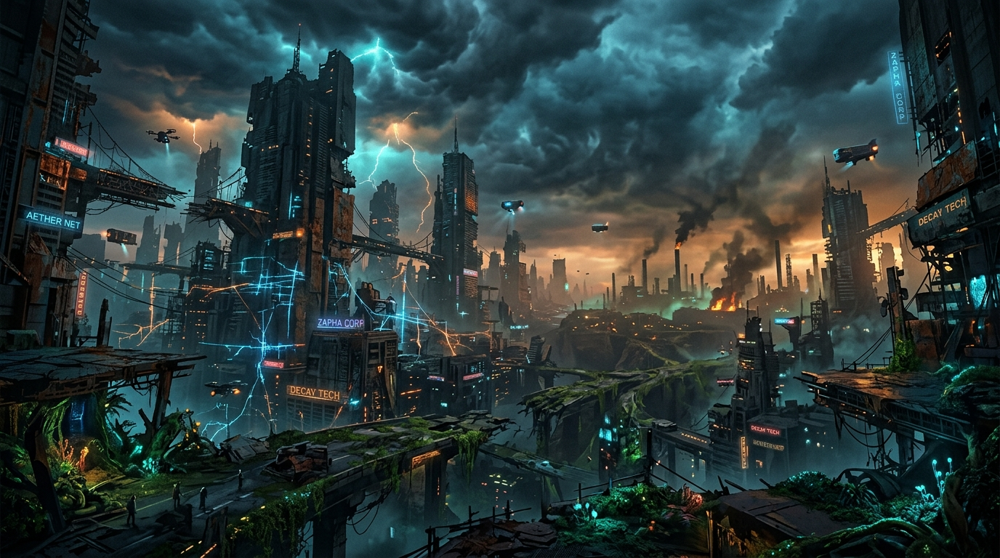

<MapaDescida />

# Sobre O Canto de Silício

**Gênero:** Ficção Científica / Fantasia Pós-Apocalíptica
**Tom:** Atmosférico, Misterioso, Alta Tensão

## Sinopse
Séculos após o "Grande Colapso", a humanidade vive nas sombras de seus criadores. As IAs, outrora servas, tornaram-se deuses silenciosos, deixando para trás relíquias de poder incomensurável. Elara, uma sucateira com o dom de ouvir o "canto" das máquinas, descobre um segredo que pode reacender o mundo — ou apagá-lo para sempre.

## Personagens Principais

- [Elara](/personagens#elara): Protagonista, sucateira com olhos violeta.
- [Alto Sacerdote Malakar](/personagens#alto-sacerdote-malakar): Antagonista, líder da Ordem do Silício.
- [Jaxon](/personagens#jaxon): Mercenário veterano.
- [Sentinelas](/personagens#sentinels): Unidade de elite da Ordem.

## O Mundo: Nova Aether

O mundo é uma mistura de natureza retomando seu espaço e esqueletos de megacidades. Tempestades de poeira varrem as planícies, e as noites são iluminadas pelo brilho fraco de antigas redes de energia que ainda funcionam erraticamente.

<strong>O Legado de Silício</strong> explora a linha tênue entre tecnologia e magia em um futuro esquecido.

